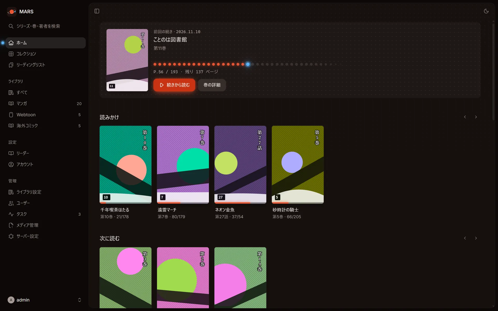

[English](README.md) | 日本語

# MARS

**MARS: A Reading Server**

*Your manga. Your server. Your universe.*



MARS は軽量でセルフホストできるコミック・マンガのサーバーです。1 つの静的な Go バイナリに、SQLite と Web UI が含まれています。フォルダをスキャンしてシリーズと巻を作り、どのブラウザからでもリーダーで読めます。外部のデータベースは必要ありません。

## 主な機能

### ライブラリ

- フォルダ単位で複数のライブラリを登録し、手動・定期・起動時にスキャンできます。
- ファイルの変更を監視して、自動でスキャンできます。
- 詳細スキャンで、ファイルの更新の有無にかかわらず再解析できます。
- 対応形式は CBZ / ZIP、CBR / RAR（RAR5 を含む）、CB7 / 7z、PDF です。
- アーカイブを入れたフォルダが、シリーズになります。
- `ComicInfo.xml` と、フォルダ内の表紙画像（cover・folder・poster など）を取り込みます。
- 除外パターンで、ディレクトリやファイルを対象から外せます。
- メタデータを Web UI から編集できます。フィールドをロックして、スキャンで上書きされないようにできます。
- 削除されたファイルはゴミ箱に残り、あとで空にできます。
- サムネイルは JPEG・WebP・AVIF から形式を選べます。

### リーダー

- 左から右、右から左、縦方向の表示に対応しています。Webtoon のような縦スクロールの連続表示と、見開き表示も使えます。
- シークレットモードで読むと、読書の進捗を保存しません。
- 進捗は保存され、次の巻へ続けて移動できます。
- 背景色は黒・グレー・白から選べます。

### コレクションとリーディングリスト

- コレクションで、シリーズを手動の順番または自動の順番でまとめられます。
- リーディングリストで、巻をまとめられます。CBL ファイルを取り込めます。
- 既読・未読を複数の巻や作品にまとめて設定できます。

### 共有と連携

- 複数のユーザーを作成できます。管理者と一般ユーザーを分けられます。
- ライブラリごとに、利用できるユーザーを制限できます。
- API キーを発行して、外部のアプリから使えます。
- OPDS 1.2 に対応しています。Panels、Chunky、KyBook などの電子書籍アプリから使えます。
- Mihon の Komga 拡張とトラッカーが使う、Komga 互換 API を備えています。
- 画面は、サーバーの変更をリアルタイムに受け取って更新されます（SSE）。
- PWA として、スマホやタブレットのホーム画面に追加できます。
- 画面は日本語と英語に対応しています。

### 運用

- 単一のバイナリで動き、Docker イメージは `linux/amd64` と `linux/arm64` に対応しています。
- タスクの進み具合を画面で確認できます。
- サムネイルの作り直しや、メディアの再解析を実行できます。
- 解析エラーや不足しているファイルを一覧で確認できます。
- 巻のファイルをダウンロードでき、シリーズをまとめて ZIP でダウンロードできます。

## クイックスタート

Docker が使える環境で、次のコマンドを実行します。`/path/to/comics` は、マンガのフォルダに置き換えてください。

```sh
docker run -d --name mars \
  -p 25600:25600 \
  -v mars-data:/data \
  -v /path/to/comics:/comics:ro \
  ghcr.io/tabunugoku/mars:1
```

1. ブラウザで http://localhost:25600 を開きます。
2. 初期設定の画面で、セットアップトークンを入力し、管理者アカウントを作ります。トークンは次のコマンドで確認できます。

   ```sh
   docker logs mars 2>&1 | grep token=
   ```

3. 管理 > ライブラリ設定 で **ライブラリを追加** を選び、フォルダに `/comics` を指定して保存します。

詳しい手順は [Docker でのインストール](docs/install/docker.ja.md) を参照してください。TrueNAS SCALE では [TrueNAS へのインストール](docs/install/truenas.ja.md) を参照してください。

## ドキュメント

- [ドキュメントの目次](docs/README.ja.md)
- [Docker でのインストール](docs/install/docker.ja.md)
- [TrueNAS へのインストール](docs/install/truenas.ja.md)
- [設定](docs/configuration.ja.md)
- [ライブラリ](docs/libraries.ja.md)
- [リーダー](docs/reading.ja.md)
- [ユーザーと権限](docs/users.ja.md)
- [OPDS と Komga 互換 API](docs/opds-komga.ja.md)
- [API](docs/api.ja.md)
- [バックアップ](docs/backup.ja.md)
- [トラブルシューティング](docs/troubleshooting.ja.md)

## フットプリント

CI で測定した値です（`.github/scripts/smoke-image.sh`）。初期設定のあと、100 冊の CBZ（各 12 ページ）と CBR・CB7 のテスト用アーカイブを含む生成したライブラリをスキャンし、サムネイルを作りました。結果は 21 シリーズ、109 冊です。測定は GitHub のホステッドランナーで行いました。

| | linux/amd64 | linux/arm64 |
| --- | --- | --- |
| イメージサイズ（展開後） | 8.0 MiB | 7.5 MiB |
| スキャン後のメモリ（`docker stats`） | 50.7 MiB | 未測定 |
| スキャン中のピークメモリ（cgroup） | 64 MiB | 未測定 |

## ソースからのビルド

Node 22 と、`server/go.mod` に書かれたバージョンの Go が必要です。バイナリは純粋な Go で作られ（`CGO_ENABLED=0`）、どの環境にもクロスコンパイルできます。

```sh
cd web && npm ci && npm run build:embed   # UI を server/internal/webui/dist にビルドします
cd ../server && CGO_ENABLED=0 go build -tags nodynamic -trimpath -ldflags="-s -w" -o mars ./cmd/mars
./mars
```

Docker イメージを作る場合は `docker build -t mars .` を実行します。開発の手順は [CONTRIBUTING.md](CONTRIBUTING.md) を参照してください。

## ロードマップ

今後の予定は [docs/roadmap.ja.md](docs/roadmap.ja.md) にまとめています。

## ライセンス

MIT ライセンスです。詳しくは [LICENSE](LICENSE) を参照してください。
