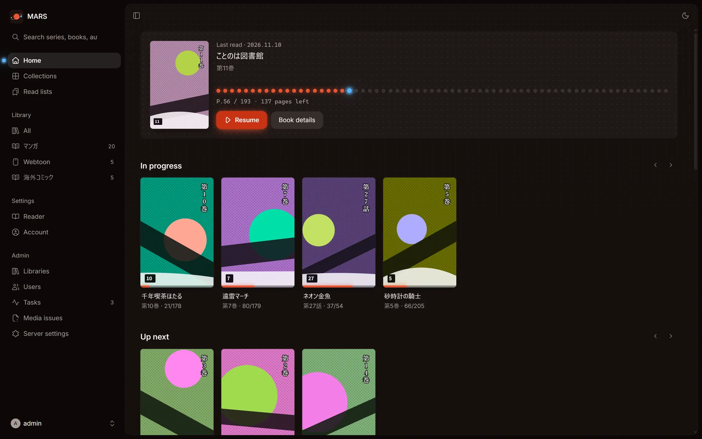

English | [日本語](README.ja.md)

# MARS

**MARS: A Reading Server**

*Your manga. Your server. Your universe.*



MARS is a lightweight, self-hosted comic and manga server. A single static Go binary includes SQLite and the web UI. It scans your folders, builds series and books, and lets you read them in the reader from any browser. It needs neither Java nor an external database.

## Key features

### Library

- Register multiple libraries by folder, and scan them manually, on a schedule, or at startup.
- Watch files for changes and scan automatically.
- A deep scan re-analyzes books whether or not their files have changed.
- Supported formats are CBZ / ZIP, CBR / RAR (including RAR5), CB7 / 7z, and PDF.
- A folder that contains archives becomes a series.
- MARS reads `ComicInfo.xml` and the cover images in each folder, such as cover, folder, and poster.
- Exclude patterns keep directories and files out of scans.
- Edit metadata in the web UI. Lock a field to keep scans from overwriting it.
- Deleted files go to the trash, and you can empty it later.
- Thumbnails can be JPEG, WebP, or AVIF.

### Reader

- Read left to right, right to left, or vertically. You can also use continuous vertical scrolling, as in a webtoon, and two-page spreads.
- Reading in incognito mode does not save your reading progress.
- Your progress is saved, and you can continue to the next book.
- Choose a background color: black, gray, or white.

### Collections and read lists

- Collections group series in a manual or automatic order.
- Read lists group books. You can import CBL files.
- Mark several books or series as read or unread at once.

### Sharing and integrations

- Create multiple users. Separate administrators from regular users.
- Limit which users can access each library.
- Issue API keys to use MARS from external apps.
- OPDS 1.2 is supported. You can use it from e-book apps such as Panels, Chunky, and KyBook.
- MARS provides a Komga-compatible API, which the Komga extension and tracker in Mihon use.
- The UI updates in real time as the server changes (SSE).
- Install MARS as a PWA on the home screen of your phone or tablet.
- The UI is available in Japanese and English.

### Operations

- MARS runs as a single binary. The Docker image supports `linux/amd64` and `linux/arm64`.
- See the progress of tasks on screen.
- Regenerate thumbnails and re-analyze media.
- View analysis errors and missing files in a list.
- Download a book's file, or download a whole series as a ZIP.

## Quick start

Run the following command on a system where Docker is available. Replace `/path/to/comics` with your comics folder.

```sh
docker run -d --name mars \
  -p 25600:25600 \
  -v mars-data:/data \
  -v /path/to/comics:/comics:ro \
  ghcr.io/tabunugoku/mars:1
```

1. Open http://localhost:25600 in your browser.
2. On the first-time setup screen, enter the setup token and create the administrator account. Run this command to find the token:

   ```sh
   docker logs mars 2>&1 | grep token=
   ```

3. Go to Admin > Libraries, select **Add library**, enter `/comics` as the folder, and save.

For more detail, see [Install with Docker](docs/install/docker.md). For TrueNAS SCALE, see [Install MARS on TrueNAS SCALE](docs/install/truenas.md).

## Documentation

- [Documentation index](docs/README.md)
- [Install with Docker](docs/install/docker.md)
- [Install MARS on TrueNAS SCALE](docs/install/truenas.md)
- [Configuration](docs/configuration.md)
- [Libraries](docs/libraries.md)
- [Reading](docs/reading.md)
- [Users and permissions](docs/users.md)
- [OPDS and the Komga-compatible API](docs/opds-komga.md)
- [API](docs/api.md)
- [Backup](docs/backup.md)
- [Troubleshooting](docs/troubleshooting.md)

## Footprint

These values were measured in CI (`.github/scripts/smoke-image.sh`). After setup, the test scanned a generated library with 100 CBZ books (12 pages each) and test archives in CBR and CB7 formats, and created thumbnails. The result was 21 series and 109 books. The measurements ran on GitHub-hosted runners.

| | linux/amd64 | linux/arm64 |
| --- | --- | --- |
| Image size (unpacked) | 8.0 MiB | 7.5 MiB |
| Memory after scan (`docker stats`) | 50.7 MiB | Not measured |
| Peak memory during scan (cgroup) | 64 MiB | Not measured |

## Building from source

You need Node 22 and the Go version listed in `server/go.mod`. The binary is pure Go (`CGO_ENABLED=0`), so it cross-compiles to any platform.

```sh
cd web && npm ci && npm run build:embed   # build the UI into server/internal/webui/dist
cd ../server && CGO_ENABLED=0 go build -tags nodynamic -trimpath -ldflags="-s -w" -o mars ./cmd/mars
./mars
```

To build the Docker image, run `docker build -t mars .`. For development steps, see [CONTRIBUTING.md](CONTRIBUTING.md).

## Roadmap

Planned work is listed in [docs/roadmap.md](docs/roadmap.md).

## License

MIT License. See [LICENSE](LICENSE) for details.
